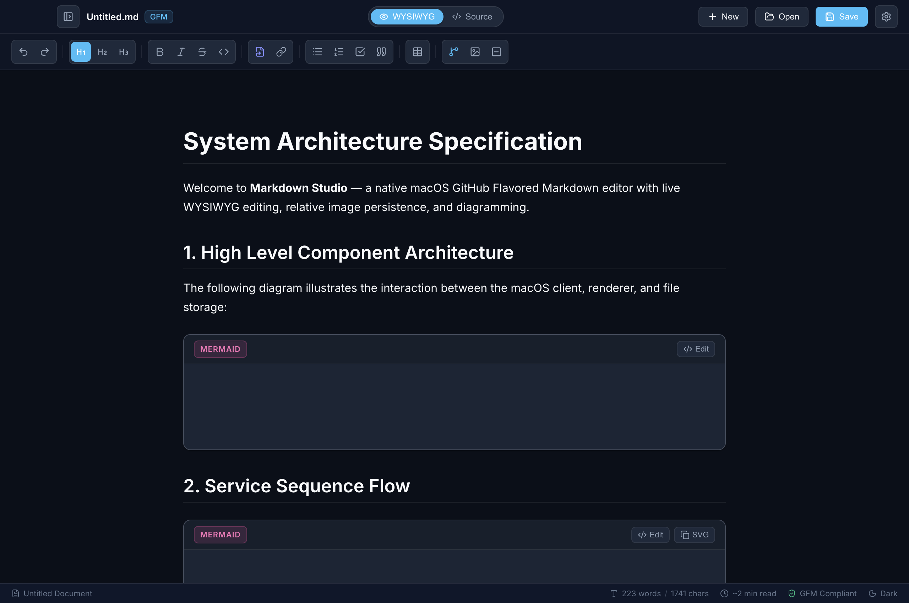
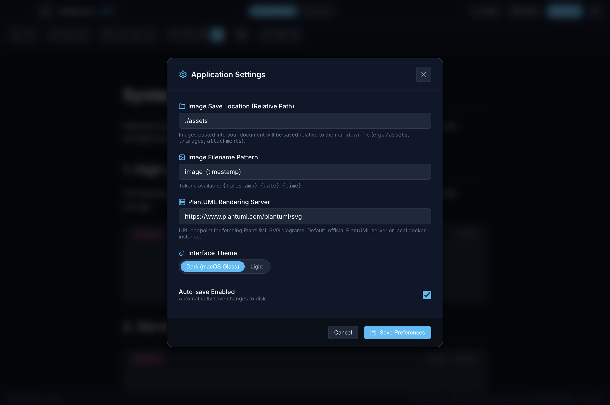

<div align="center">

  

  # Markdown Studio

  **A sleek, native cross-platform GitHub Flavored Markdown (GFM) editor with live WYSIWYG editing, relative image persistence, and inline diagramming for macOS & Windows.**

  [](https://github.com/jameslloyd/markdownstudio)
  [](https://github.com/jameslloyd/markdownstudio)
  [](https://github.com/jameslloyd/markdownstudio)
  [](https://github.github.com/gfm/)
  [](https://mermaid.js.org/)
  [](https://github.com/jameslloyd/markdownstudio)
  [](https://github.com/jameslloyd/markdownstudio/releases/latest)

</div>

---

## 📸 Screenshots

### 1. Typora / Notion-Style WYSIWYG Editor with Live Mermaid Architecture Diagram
> Seamlessly edit rendered Markdown with live diagrams, interactive checklists, and formatted tables. Toggle to raw source mode anytime with <kbd>Cmd</kbd> + <kbd>E</kbd>.

<p align="center">
  
</p>

---

### 2. Built-in Diagram Presets (Mermaid & PlantUML)
> Insert Flowcharts, Sequence Diagrams, Class Diagrams, State Machines, Git Graphs, and Mindmaps with one click.

<p align="center">
  
</p>

---

### 3. Application Preferences & Relative Image Settings
> Configure relative image folder destination (e.g., `./assets`, `./images`), naming conventions, PlantUML rendering server, and auto-save timers.

<p align="center">
  
</p>

---

## ✨ Features

- **GitHub Flavored Markdown (GFM)**:
  - First-class support for tables, checklists / task lists (`- [x]`), blockquotes, code blocks with language indicators, strikethrough, and links.
- **Typora / Notion-Style WYSIWYG**:
  - Live in-place document editing with interactive task check-boxes and table column/row controls.
  - **Source Mode Toggle (<kbd>Cmd</kbd> + <kbd>E</kbd>)**: Instant bidirectional sync between live WYSIWYG and raw monospace markdown text.
- **Relative Image Pasting & Drag-and-Drop**:
  - Copy any screenshot or graphic to your clipboard and paste directly (<kbd>Cmd</kbd> + <kbd>V</kbd>) into the editor.
  - Automatically writes the image to disk relative to the current Markdown document (e.g. `./assets/image-YYYYMMDD-HHMMSS.png`).
  - Supports drag-and-drop of image files from Finder.
  - Renders immediately via a sandboxed custom local file protocol (`md-local://`).
- **Diagramming Support (Mermaid & PlantUML)**:
  - **Mermaid**: 100% local, client-side offline SVG engine with live in-place code editing, syntax error validation, and SVG export.
  - **PlantUML**: Live diagram rendering via URL Deflate encoding with configurable server endpoints.
- **macOS Native Aesthetics & Integration**:
  - Native macOS inset titlebar (`hiddenInset`) with integrated traffic light buttons.
  - System application menu with full keyboard shortcuts (<kbd>Cmd</kbd> + <kbd>N</kbd>, <kbd>Cmd</kbd> + <kbd>O</kbd>, <kbd>Cmd</kbd> + <kbd>S</kbd>, <kbd>Cmd</kbd> + <kbd>Shift</kbd> + <kbd>S</kbd>, <kbd>Cmd</kbd> + <kbd>,</kbd>).
  - Collapsible Table of Contents (Outline) drawer, word and character counters, and reading time estimation.
  - Glassmorphic dark theme and crisp light theme.

---

## 🚀 Getting Started

### Prerequisites
- macOS 12+ (Apple Silicon or Intel)
- Node.js (v18+)
- npm

### Installation
Clone the repository and install dependencies:
```bash
git clone https://github.com/jameslloyd/markdownstudio.git
cd markdownstudio
npm install
```

### Running Locally
- **Development Mode** (with Vite live hot-reload & Electron):
  ```bash
  npm run dev
  ```

- **Local Run** (Compiles frontend and launches Electron):
  ```bash
  npm run build
  npm start
  ```

- **Web Browser Run** (Runs lightweight Node.js web server on `http://localhost:3000`):
  ```bash
  npm run web
  ```

---

## 🐳 Running on the Web via Docker

Markdown Studio can be deployed and run directly inside a Docker container with zero desktop dependencies, offering full WYSIWYG editing, diagramming, and persistent file storage in any web browser.

### Option 1: Docker Compose (Recommended)

1. Start the container in the background:
   ```bash
   docker compose up -d
   ```
2. Open your browser and navigate to:
   ```
   http://localhost:3000
   ```
3. Your markdown documents and pasted images persist in the local `./documents` directory on your host machine.
4. Stop the container:
   ```bash
   docker compose down
   ```

### Option 2: Docker CLI

1. Build the multi-stage production Docker image:
   ```bash
   docker build -t markdown-studio .
   ```
2. Run the container with volume mounts for persistence:
   ```bash
   docker run -d \
     --name markdown-studio \
     -p 3000:3000 \
     -v "$(pwd)/documents:/app/documents" \
     -v "$(pwd)/data:/app/data" \
     markdown-studio
   ```

---

## 📦 Compiling Native Binaries (.app, .dmg, .exe)

Build standalone installers and portable packages for macOS and Windows:

### 🍏 macOS
```bash
# Compile macOS .dmg installer and .app bundle
npm run dist
```
Generated artifacts in `release/`:
- `release/Markdown Studio-1.0.0-arm64.dmg` — Drag-and-drop macOS installer
- `release/mac-arm64/Markdown Studio.app` — Standalone macOS application bundle
- `release/Markdown Studio-1.0.0-arm64-mac.zip` — Portable distribution archive

### 🪟 Windows
```bash
# Compile Windows NSIS installer and portable executable
npm run dist:win
```
Generated artifacts in `release/`:
- `release/Markdown Studio Setup 1.0.0.exe` — Windows NSIS Installer (with Start Menu & Desktop shortcuts)
- `release/Markdown Studio 1.0.0.exe` — Standalone Portable executable (no install required)
- `release/Markdown Studio-1.0.0-win.zip` — Portable distribution ZIP package

---

## 📥 Downloads & Releases

Pre-built binaries for macOS and Windows are available on the [GitHub Releases Page](https://github.com/jameslloyd/markdownstudio/releases/latest).

---

## ⌨️ Keyboard Shortcuts

| Shortcut | Description |
| :--- | :--- |
| <kbd>Cmd</kbd> + <kbd>N</kbd> | New Document |
| <kbd>Cmd</kbd> + <kbd>O</kbd> | Open Markdown File... |
| <kbd>Cmd</kbd> + <kbd>S</kbd> | Save Document |
| <kbd>Cmd</kbd> + <kbd>Shift</kbd> + <kbd>S</kbd> | Save Document As... |
| <kbd>Cmd</kbd> + <kbd>E</kbd> | Toggle WYSIWYG / Raw Source Mode |
| <kbd>Cmd</kbd> + <kbd>,</kbd> | Preferences & Settings |
| <kbd>Cmd</kbd> + <kbd>B</kbd> | Bold Text |
| <kbd>Cmd</kbd> + <kbd>I</kbd> | Italic Text |
| <kbd>Cmd</kbd> + <kbd>Z</kbd> | Undo |
| <kbd>Cmd</kbd> + <kbd>Shift</kbd> + <kbd>Z</kbd> | Redo |

---

## ⚙️ Settings & Customization

Click the **Preferences** gear icon or press <kbd>Cmd</kbd> + <kbd>,</kbd> to configure:
1. **Image Save Location**: Relative directory path for pasted images (e.g. `./assets`, `./images`, `attachments`).
2. **Filename Pattern**: Customize auto-generated filenames (tokens: `{timestamp}`, `{date}`, `{time}`).
3. **PlantUML Server**: URL endpoint for PlantUML diagrams (default: official server or your local container).
4. **Theme**: Switch between Dark (macOS Glass) and Light mode.
5. **Auto-save**: Enable background auto-saving and adjust the timer interval.

---

## 📄 License

MIT License. Open source for all markdown enthusiasts.
